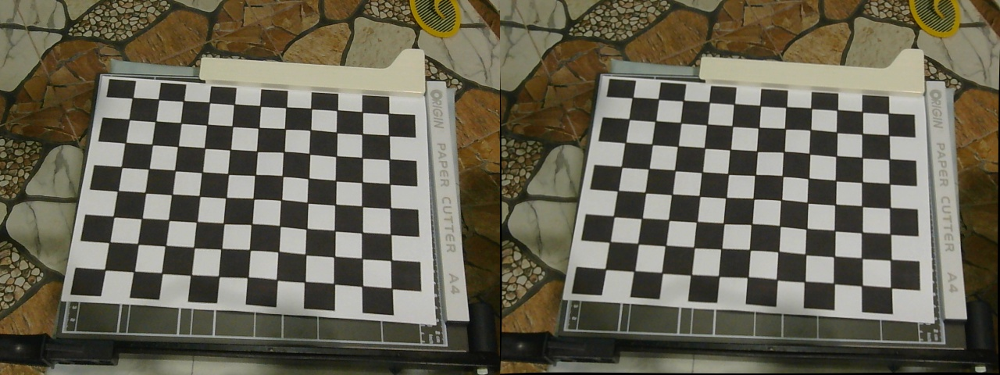

# P1 – Real-time Camera Calibration & Undistortion

Bagian ini berisi implementasi dan hasil **Kalibrasi Kamera Eksternal Secara Real-time** menggunakan OpenCV dan pola papan catur (*checkerboard pattern*).

---

## 🎯 Tujuan
1. Mengestimasi parameter intrinsik kamera (focal length $f_x, f_y$, principal point $c_x, c_y$) dan koefisien distorsi lensa ($k_1, k_2, p_1, p_2, k_3$).
2. Menghilangkan efek distorsi lensa (*radial & tangential distortion*) pada streaming video kamera eksternal secara langsung (*real-time*).
3. Menyimpan matriks kalibrasi ke dalam file `realtime_calibration.npz` untuk digunakan pada pipeline klasifikasi objek (P2).

---

## 📐 Konfigurasi Kalibrasi
- **Kamera**: Kamera Eksternal (Webcam USB - Resolusi $640 \times 480$)
- **Pola Papan Catur**: $9 \times 12$ kotak (inner corners: $8 \times 11$)
- **Jumlah Sampel**: 30 frame dengan variasi sudut, jarak, kemiringan, dan posisi pada bidang pandang lensa.
- **Kriteria Konvergensi**: `cv2.TERM_CRITERIA_EPS + cv2.TERM_CRITERIA_MAX_ITER` (30 iterasi atau akurasi 0.001).

---

## 📁 Struktur Berkas P1
```
P1_Camera_Calibration_Realtime/
├── realtimeCameraCalibration.py       # Program utama kalibrasi interaktif real-time
├── save_realtime_result.py            # Penampil komparasi live side-by-side (Original vs Undistorted)
├── calibration_utils.py               # Utilitas pembantu deteksi checkerboard & optimasi
├── realtime_calibration.npz           # Matriks kamera (K) & koefisien distorsi (D) yang tersimpan
├── tests/
│   └── test_camera_calibration_realtime.py  # Unit test regresi kalibrasi
└── output/
    ├── realtime_comparison.jpg        # Foto perbandingan Original vs Undistorted
    ├── realtime_original.jpg          # Tangkapan frame asli dengan distorsi
    ├── realtime_undistorted.jpg       # Tangkapan frame setelah koreksi distorsi
    └── samples/                       # 30 sampel citra checkerboard yang ditangkap saat kalibrasi
        ├── sample_01.jpg ... sample_30.jpg
```

---

## 🖼️ Hasil Kalibrasi & Undistortion Real-time

### Perbandingan Langsung (Original vs Undistorted)


*Pada gambar perbandingan di atas, garis lurus pada latar belakang dan objek yang semula melengkung akibat distorsi barel (*barrel distortion*) telah terkoreksi secara efektif menjadi tegak lurus pada frame sebelah kanan.*

---

## 🚀 Cara Menjalankan

### 1. Menjalankan Kalibrasi Kamera Real-time
Pastikan kamera eksternal terhubung, lalu jalankan:
```bash
python realtimeCameraCalibration.py
```
**Kontrol Keyboard:**
- `SPACE` : Menangkap frame checkerboard saat sudut terdeteksi (disimpan ke `output/samples/`).
- `C` : Memulai kalkulasi kalibrasi setelah mengumpulkan $\ge 15$ sampel.
- `S` : Menyimpan parameter kalibrasi ke `realtime_calibration.npz` dan frame evaluasi.
- `R` : Reset frame yang sudah ditangkap.
- `Q` / `ESC` : Keluar dari program.

### 2. Menampilkan Perbandingan Live Real-time
Untuk melihat streaming live kamera berdampingan (*side-by-side*):
```bash
python save_realtime_result.py
```
- Tekan `SPACE` untuk mengambil foto komparasi ke folder `output/`.
- Tekan `Q` untuk keluar.

### 3. Menjalankan Pengujian Otomatis
```bash
python -m unittest tests/test_camera_calibration_realtime.py
```
