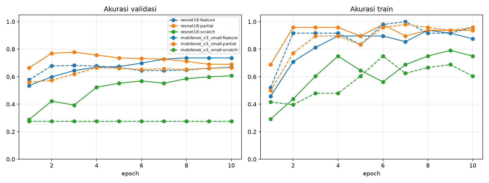
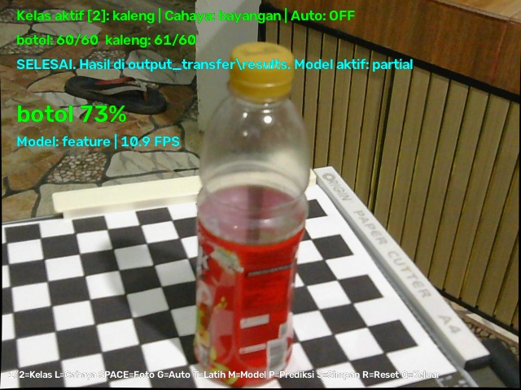
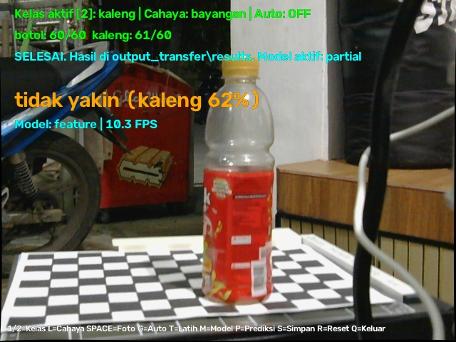
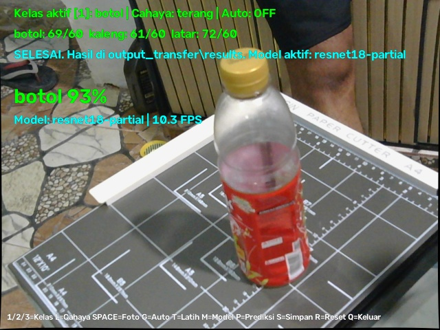
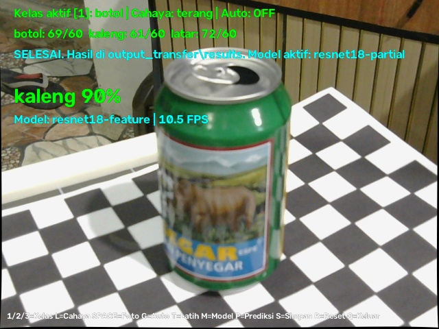

# P2 – Real-time Transfer Learning dengan Kamera Eksternal

Bagian ini berisi implementasi lengkap, pelatihan, dan inferensi real-time dari **Transfer Learning untuk Klasifikasi Objek (Botol vs Kaleng + Latar)** menggunakan kamera eksternal yang terintegrasi dengan pipeline kalibrasi kamera (P1).

---

## 🎯 Tujuan & Pipeline
1. Mengintegrasikan koreksi distorsi lensa secara real-time langsung ke pipeline input model deep learning.
2. Membandingkan performa 3 mode pelatihan transfer learning:
   - **Feature Extraction** (membekukan backbone, melatih *classification head* saja)
   - **Partial Fine-tuning** (membuka beberapa layer atas untuk adaptasi domain)
   - **Train from Scratch** (melatih seluruh bobot dari inisialisasi acak)
3. Membandingkan dua arsitektur deep learning: **ResNet-18** (akurasi tinggi) vs **MobileNetV3-Small** (efisiensi tinggi untuk edge/real-time).
4. Melakukan inferensi langsung (*real-time classification*) melalui streaming kamera eksternal dengan overlay informasi kelas, keyakinan (*confidence*), dan FPS.

```
[Kamera Eksternal] 
        │
        ▼ (640x480 frame)
[Undistortion P1 (realtime_calibration.npz)] 
        │
        ▼ (Frame terkoreksi)
[Preprocessing: Resize 224x224 → RGB → ImageNet Normalization] 
        │
        ▼
[Model: ResNet-18 / MobileNetV3-Small] 
        │
        ▼
[Inference Real-time (Botol / Kaleng / Latar)]
```

---

## 📊 Hasil Eksperimen

### 1. Evaluasi 3 Mode Pelatihan (ResNet-18)
Kondisi validasi: *jendela*, *terang* (pencegahan kebocoran data / *data leakage*).

| Mode Pelatihan | Akurasi Validasi Terbaik | Waktu Latih | Epoch Capai $\ge$ 90% |
| :--- | :---: | :---: | :---: |
| **Feature Extraction** | **93.5%** | 105 s | Epoch 5 |
| **Partial Fine-Tuning** | **100.0%** | 118 s | **Epoch 2** |
| **Train from Scratch** | **90.9%** | 155 s | Epoch 10 |

---

### 2. Perbandingan Model: ResNet-18 vs MobileNetV3-Small (3 Kelas)
Kelas target: `botol`, `kaleng`, `latar`.

| Model | Parameter | Feature Ext. | Partial Fine-tuning | Scratch | Inferensi (ms/frame) | Throughput (FPS) |
| :--- | :---: | :---: | :---: | :---: | :---: | :---: |
| **ResNet-18** | 11.2M | **73.6%** | **77.8%** | 60.7% | 93.14 ms | 10.7 FPS |
| **MobileNetV3-Small** | 1.5M | 68.2% | 66.5% | 27.6% | **22.02 ms** | **45.4 FPS** |

**Grafik Akurasi per Epoch:**


---

### 3. Analisis Anggaran Latensi Pipeline Nyata
Pengujian dilakukan pada perangkat nyata dengan pipeline penuh:
- **Akuisisi + Undistort**: ~12.5 ms
- **Preprocessing (Resize, RGB, Norm)**: ~1.8 ms
- **Inferensi Model**:
  - ResNet-18: ~93 ms (~10-11 FPS)
  - MobileNetV3-Small: ~22 ms (~45 FPS)
- **Postprocessing & Render UI**: ~1.2 ms
- **Kesimpulan Latensi**: MobileNetV3-Small sangat ideal untuk sistem real-time interaktif dengan frame-rate di atas 30 FPS, sedangkan ResNet-18 menawarkan akurasi tertinggi untuk skenario yang mengutamakan ketepatan deteksi.

---

## 📸 Snapshot Inferensi Real-time
Berikut beberapa contoh hasil deteksi langsung dari kamera eksternal:

| Deteksi Botol | Deteksi Kaleng |
| :---: | :---: |
|  |  |
|  |  |

---

## 📁 Struktur Berkas P2
```
P2_Transfer_Learning_Realtime/
├── realtime_transfer_learning.py  # GUI terpadu: capture data, train, live predict
├── realtime_classify.py           # Skrip CLI inferensi live ringan
├── common.py                      # Pipeline bersama (undistort, prep, model builder)
├── capture.py                     # Tool akuisisi dataset per kondisi
├── split.py                       # Pembagian train/val anti-data leakage
├── train.py                       # Skrip pelatihan 3 mode
├── latency.py                     # Pengujian latensi dan benchmark FPS
├── report.py                      # Pembuat visualisasi grafik dan tabel
├── check_cameras.py               # Utilitas cek index kamera eksternal
├── check_camera_resolution.py     # Utilitas cek resolusi kamera
├── models/                        # Checkpoint model terlatih (.pt)
│   ├── resnet18_feature.pt
│   ├── resnet18_partial.pt
│   ├── resnet18_scratch.pt
│   ├── mobilenet_v3_small_feature.pt
│   ├── mobilenet_v3_small_partial.pt
│   └── mobilenet_v3_small_scratch.pt
├── results/                       # Log evaluasi (.json) dan grafik akurasi
│   ├── akurasi_per_epoch.png
│   ├── hasil_3_mode.md
│   └── hasil_perbandingan.md
├── snapshots/                     # Bukti tangkapan layar klasifikasi live
├── dataset_raw/                   # Dataset foto asli dengan metadata
│   ├── metadata.csv
│   ├── botol/
│   ├── kaleng/
│   └── latar/
└── dataset/                       # Dataset hasil split train dan val
```

---

## 🚀 Cara Menjalankan

### 1. Menjalankan Aplikasi Real-time Terpadu (GUI)
Aplikasi ini memungkinkan akuisisi data, pelatihan on-the-fly, dan klasifikasi real-time dalam satu tampilan interaktif:
```bash
python realtime_transfer_learning.py
```
**Kontrol Keyboard:**
- `1` / `2` / `3` : Memilih kelas aktif (`botol` / `kaleng` / `latar`).
- `L` : Mengganti label kondisi pencahayaan (`terang` / `redup` / `jendela` / `bayangan`).
- `SPACE` : Mengambil 1 foto untuk kelas aktif.
- `G` : Mengaktifkan / mematikan auto-capture berkala (1 foto tiap 0.4 detik).
- `T` : Melatih model (ResNet-18 & MobileNetV3-Small) pada seluruh 3 mode.
- `M` : Mengganti model aktif untuk prediksi.
- `P` : Mengaktifkan / mematikan prediksi live.
- `S` : Menyimpan tangkapan layar hasil klasifikasi ke folder `snapshots/`.
- `Q` / `ESC` : Keluar.

### 2. Menjalankan Klasifikasi Real-time Standalone (CLI)
Gunakan model hasil pelatihan (misal `resnet18_partial.pt`):
```bash
python realtime_classify.py --cam 2 --ckpt models/resnet18_partial.pt
```

### 3. Menguji Latensi Pipeline
```bash
# Uji latensi model saja
python latency.py

# Uji latensi pipeline penuh (kamera + undistort + model)
python latency.py --cam 2 --ckpt models/resnet18_partial.pt
```
