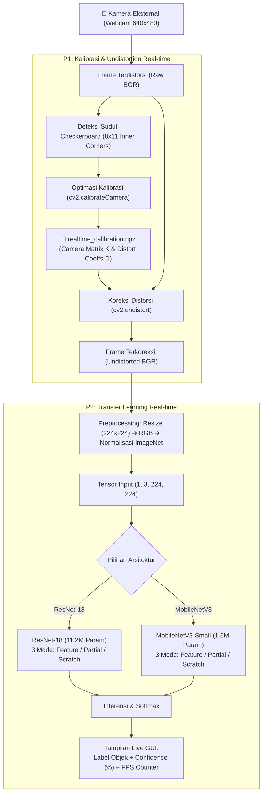

# Real-time Camera Calibration & Transfer Learning

[](https://www.python.org/)
[](https://opencv.org/)
[](https://pytorch.org/)
[]()

Repositori ini berisi implementasi terintegrasi untuk dua tugas Computer Vision berbasis **kamera eksternal real-time**:
1. **P1 – Real-time Camera Calibration & Undistortion**: Kalibrasi matriks kamera intrinsik dan distorsi lensa secara live menggunakan pola papan catur (*checkerboard*), serta koreksi distorsi (*undistortion*) langsung pada streaming video.
2. **P2 – Real-time Transfer Learning**: Klasifikasi objek langsung (*live object classification*) antara kelas **botol**, **kaleng**, dan **latar** dengan mengintegrasikan koreksi distorsi P1 ke dalam pipeline preprocessing PyTorch. Proyek ini membandingkan 3 pendekatan pelatihan (*Feature Extraction*, *Partial Fine-tuning*, *Train from Scratch*) pada dua arsitektur (*ResNet-18* dan *MobileNetV3-Small*).

---

## 🏗️ Arsitektur & Pipeline Sistem Terintegrasi

Sistem menggabungkan hasil kalibrasi dari P1 sebagai modul normalisasi geometri lensa sebelum citra diproses oleh model Deep Learning pada P2:



---

## 📂 Struktur Repositori

```
TRANSFER-LEARNING/
├── README.md                              # Dokumentasi utama proyek (halaman ini)
├── requirements.txt                       # Dependensi proyek (torch, torchvision, opencv-python, numpy, matplotlib)
├── .gitignore                             # Konfigurasi pengabaian file sementara / cache
│
├── P1_Camera_Calibration_Realtime/        # Modul P1: Kalibrasi Kamera Real-time
│   ├── README.md                          # Dokumentasi detail P1
│   ├── realtimeCameraCalibration.py       # Program kalibrasi interaktif real-time
│   ├── save_realtime_result.py            # Program visualisasi side-by-side (Original vs Undistorted)
│   ├── calibration_utils.py               # Utilitas deteksi sudut & optimasi kalibrasi
│   ├── realtime_calibration.npz           # Hasil parameter matriks kamera & distorsi
│   ├── tests/
│   │   └── test_camera_calibration_realtime.py # Unit test kalibrasi
│   └── output/
│       ├── realtime_comparison.jpg        # Foto perbandingan Original vs Undistorted
│       ├── realtime_original.jpg          # Sampel frame asli dengan distorsi
│       ├── realtime_undistorted.jpg       # Sampel frame setelah koreksi distorsi
│       └── samples/                       # 30 sampel citra kalibrasi checkerboard
│           ├── sample_01.jpg ... sample_30.jpg
│
└── P2_Transfer_Learning_Realtime/         # Modul P2: Transfer Learning Real-time
    ├── README.md                          # Dokumentasi detail P2 & laporan teknis
    ├── realtime_transfer_learning.py      # Aplikasi GUI terpadu (capture, train, live predict)
    ├── realtime_classify.py               # CLI klasifikasi live real-time
    ├── common.py                          # Modul bersama (pipeline undistort, prep, model builder)
    ├── capture.py                         # Tool akuisisi dataset dengan logging kondisi cahaya
    ├── split.py                           # Pembagian train/val anti-data leakage
    ├── train.py                           # Script pelatihan 3 mode transfer learning
    ├── latency.py                         # Benchmark latensi dan throughput (FPS)
    ├── report.py                          # Generator grafik akurasi dan tabel perbandingan
    ├── check_cameras.py                   # Utilitas deteksi index kamera eksternal
    ├── check_camera_resolution.py         # Utilitas deteksi resolusi kamera
    ├── models/                            # Checkpoint model terlatih (.pt)
    │   ├── resnet18_feature.pt
    │   ├── resnet18_partial.pt
    │   ├── resnet18_scratch.pt
    │   ├── mobilenet_v3_small_feature.pt
    │   ├── mobilenet_v3_small_partial.pt
    │   └── mobilenet_v3_small_scratch.pt
    ├── results/                           # Metrik evaluasi (.json) dan grafik performa
    │   ├── akurasi_per_epoch.png          # Grafik akurasi per epoch
    │   ├── hasil_3_mode.md                # Evaluasi 3 mode ResNet-18
    │   └── hasil_perbandingan.md          # Evaluasi komparatif ResNet-18 vs MobileNetV3-Small
    ├── snapshots/                         # Snapshot inferensi klasifikasi real-time
    │   ├── hasil_botol_*.jpg
    │   ├── hasil_kaleng_*.jpg
    │   └── hasil_frame_*.jpg
    ├── dataset_raw/                       # Dataset citra mentah dengan metadata kondisi pencahayaan
    │   ├── metadata.csv
    │   ├── botol/
    │   ├── kaleng/
    │   └── latar/
    └── dataset/                           # Dataset yang telah dibagi train/val
```

---

## 📌 Rangkuman P1: Real-time Camera Calibration

- **Pola Kalibrasi**: Papan catur 9x12 kotak (8x11 *inner corners*).
- **Resolusi**: $640 \times 480$ pada kamera eksternal USB.
- **Sampel**: 30 frame valid yang mencakup berbagai orientasi dan posisi lensa.
- **Keluaran**: Matriks intrinsik ($K$) dan vektor distorsi ($D$) disimpan ke dalam `realtime_calibration.npz`.

### Hasil Visualisasi Koreksi Distorsi Lensa


---

## 📌 Rangkuman P2: Real-time Transfer Learning

### 1. Desain Dataset & Pencegahan *Data Leakage*
- **Kelas**: `botol`, `kaleng`, dan `latar` (kelas negatif agar model tidak salah memprediksi ruangan kosong).
- **Kondisi Lingkungan**: Setiap objek diambil dalam variasi pencahayaan: `terang`, `redup`, `jendela`, dan `bayangan`.
- **Anti Data Leakage**: Pembagian train dan validasi dilakukan **berdasarkan kondisi lingkungan** (misal kondisi jendela dan terang sebagai set validasi), bukan pemisahan acak (*random shuffle*), untuk memastikan model mampu melakukan generalisasi ke domain yang belum pernah dilihat.

### 2. Evaluasi 3 Pendekatan Pelatihan (ResNet-18)
| Mode Pelatihan | Akurasi Val Terbaik | Waktu Latih | Epoch Capai $\ge$ 90% |
| :--- | :---: | :---: | :---: |
| **Feature Extraction** | 93.5% | 105 s | Epoch 5 |
| **Partial Fine-Tuning** | **100.0%** | 118 s | **Epoch 2** |
| **Train from Scratch** | 90.9% | 155 s | Epoch 10 |

*Analisis: Partial Fine-tuning mencapai konvergensi tercepat (epoch 2) dan akurasi tertinggi karena bobot konvolusi ImageNet diadaptasi secara halus ke karakteristik sensor kamera eksternal.*

### 3. Perbandingan Model: ResNet-18 vs MobileNetV3-Small
| Model | Parameter | Feature Ext. | Partial Fine-tuning | Scratch | Latensi Model | FPS |
| :--- | :---: | :---: | :---: | :---: | :---: | :---: |
| **ResNet-18** | 11.2 Juta | 73.6% | **77.8%** | 60.7% | 93.14 ms | 10.7 FPS |
| **MobileNetV3-Small** | 1.5 Juta | 68.2% | 66.5% | 27.6% | **22.02 ms** | **45.4 FPS** |

**Kurva Pembelajaran:**


### 4. Contoh Snapshot Inferensi Real-time
| Deteksi Objek: Botol | Deteksi Objek: Kaleng |
| :---: | :---: |
|  |  |

---

## ⚡ Panduan Instalasi & Penggunaan

### 1. Kloning Repositori & Instalasi Dependensi
```bash
git clone https://github.com/rizky-strg/TRANSFER-LEARNING.git
cd TRANSFER-LEARNING

# Buat virtual environment (opsional namun disarankan)
python -m venv .venv
.venv\Scripts\activate   # Windows

# Instalasi seluruh library yang dibutuhkan
pip install -r requirements.txt
```

### 2. Menjalankan P1 (Kalibrasi Kamera Real-time)
```bash
cd P1_Camera_Calibration_Realtime

# Kalibrasi interaktif
python realtimeCameraCalibration.py

# Menampilkan streaming live original vs undistorted
python save_realtime_result.py
```

### 3. Menjalankan P2 (Transfer Learning Real-time)
```bash
cd ../P2_Transfer_Learning_Realtime

# Menjalankan aplikasi GUI real-time terpadu (capture, train, predict)
python realtime_transfer_learning.py

# Atau menjalankan inferensi live langsung dengan checkpoint tertentu
python realtime_classify.py --cam 2 --ckpt models/resnet18_partial.pt

# Menguji benchmark latensi
python latency.py
```

---

## 👥 Penulis & Lisensi
- **Repository**: [rizky-strg/TRANSFER-LEARNING](https://github.com/rizky-strg/TRANSFER-LEARNING)
- Dikembangkan untuk pemenuhan tugas akademik Pengolahan Citra Digital / Computer Vision: Kalibrasi Kamera Real-time (P1) & Transfer Learning (P2).